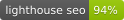

# Packet Analysis with Tshark

[](https://app.netlify.com/sites/pedantic-lumiere-bf6286/deploys)




<br><br>
<a href="https://tshark.dev"></a>
<br><br>

[tshark.dev](https://tshark.dev) exists to teach you about packet analysis using **tshark**, the command-line packet analyzer that's part of the Wireshark project.

## About tshark and Wireshark

- **tshark** (lowercase) is the command-line network protocol analyzer
- **Wireshark** refers to:
  - The GUI application for packet analysis
  - The Wireshark project/suite of tools (which includes tshark, dumpcap, editcap, and more)

This site focuses primarily on command-line packet analysis with **tshark**, though many concepts apply across the entire Wireshark suite.

The main aim for the site is to provide example usage of working with packets and hopefully give back something to the networking community in the process.

This website is built using [hugo](https://gohugo.io/), an open-source static site generator. Most of the HTML/CSS/JS, shortcodes, and partials come from the [Learn Theme](https://learn.netlify.com/en/).

## Build it

### Serve tshark.dev locally

1. Download the repo

   ```
   git clone https://github.com/pocc/tshark.dev
   cd tshark.dev
   ```

2. [Install hugo](https://gohugo.io/getting-started/installing/)

3. Start the server: `hugo server`

4. Open the address in a browser (default is localhost:1313)

## Accessibility checks

Use Hugo **0.155.2** for reproducible builds. The site is light-only, uses the original root documentation URLs, and redirects older `/en/` URLs to the matching page.

```sh
npm ci
npx playwright install chromium
npm run build
npm run audit:a11y
```

The audit recursively inventories the generated site, checks each page in desktop light, saved-dark-preference, mobile, and 320px reflow views, and verifies keyboard navigation, search, copy feedback, capture-table filtering, and old URL redirects. It exits unsuccessfully for automated accessibility failures, broken internal links, JavaScript errors, or failed interaction checks.

Results and representative screenshots are written to `artifacts/accessibility/`. The GitHub **Accessibility checks** workflow runs the same checks on pushes and pull requests and uploads the report. It does not deploy the site or require Cloudflare credentials. See [the page-by-page audit](docs/ACCESSIBILITY_AUDIT.md) for findings, verification, and remaining human-review limits. Automated checks do not replace screen-reader testing or caption/image review.

The first-party browser scan blocks analytics, comments, and external Asciinema recording requests. This keeps unavailable third-party recordings from preventing article checks. Recording playback, accessibility, captions/transcripts, and external service availability remain explicitly flagged for separate review (M03).

To use an already-installed compatible headless browser, set `PLAYWRIGHT_CHROMIUM_EXECUTABLE_PATH` to its executable. Otherwise install the browser with Playwright as shown above.

## Contributing

<a href="https://www.patreon.com/bePatron?u=23107486"></a>

Support me if you like good documentation!

### Raising an Issue

Apart from manually adding an issue, there are multiple ways to raise an issue for this website:

- <u>**Edit this page**</u>: Every page has a link in the upper right corner that can click on to see the page in github. You can then make a pull request once you are satisfied with your changes.
- <u>**Comment**</u>: At the bottom of every article, there is a comments section that is tied to github issues.
- <u>**Email**</u>: If you do not want to use github, you can interact with the contributors by emailing tshark_dev[АТ]fire.fundersclub.com. This will make a github issue that functions like an email chain. As this is public, do not put any PII or sensitive information in it.
- <u>**Contact**</u>: If you do not want your issue to be public, you can contact me directly at rj[АТ]tshark.dev

### Submitting a Pull Request

Contributions to the site are greatly appreciated, if you see a typo or
something that isn't quite right and want to help improve the site for everyone
then please feel free to submit a pull request.

- Start off by forking the repository
- Make any changes you have in mind
- Submit a Pull Request from your forked version back into the original version
  of the site
- I'll review it and approve it
- It'll automatically go live in seconds!

A list of contributors is available [here](https://github.com/pocc/tshark.dev/graphs/contributors).

## Guide Philosophy

- If you can't understand an article, that's a bug
- Bad style and tone are high-priority issues
- Prefer linking to articles than writing new ones
- Link to manpages/Wireshark docs wherever relevant
- Further reading links should provide something that the article above it does not
